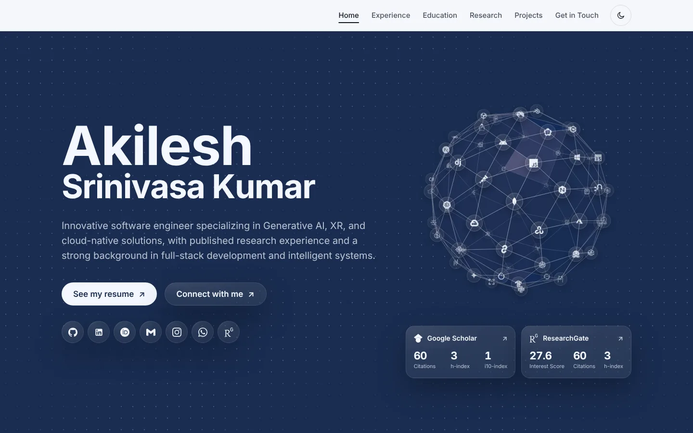
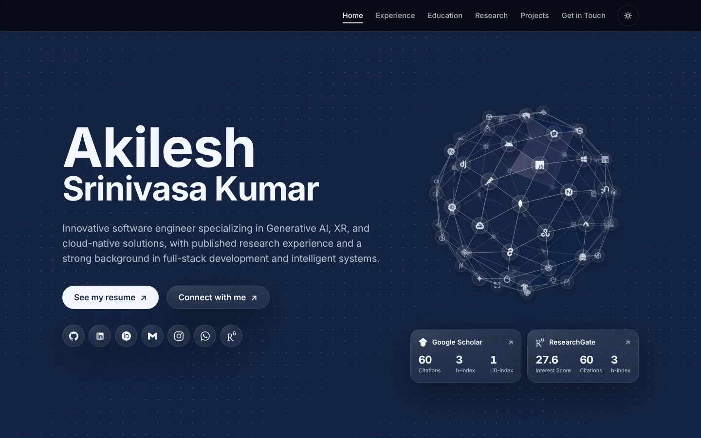
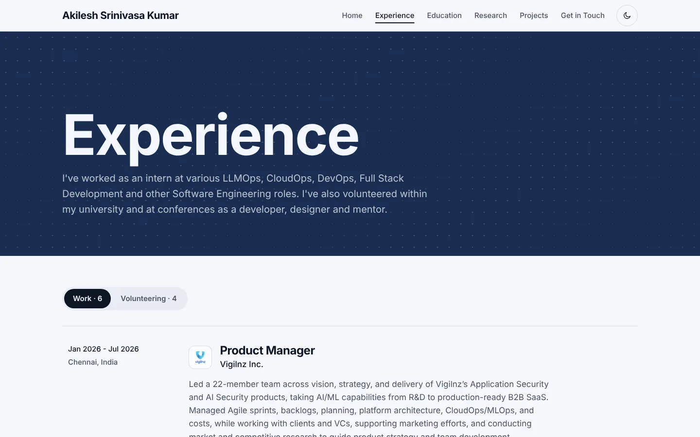
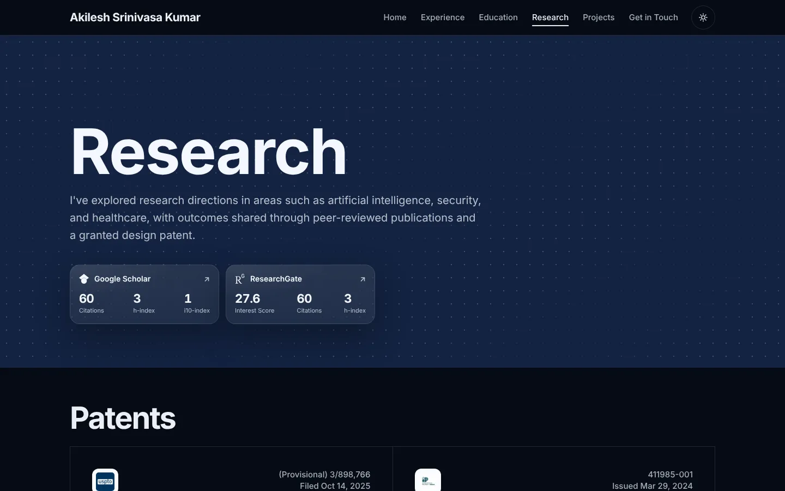
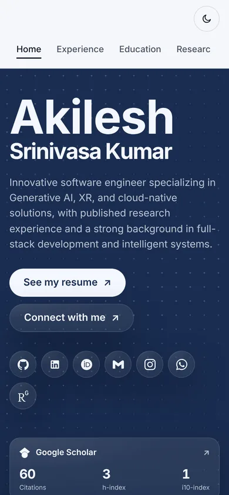
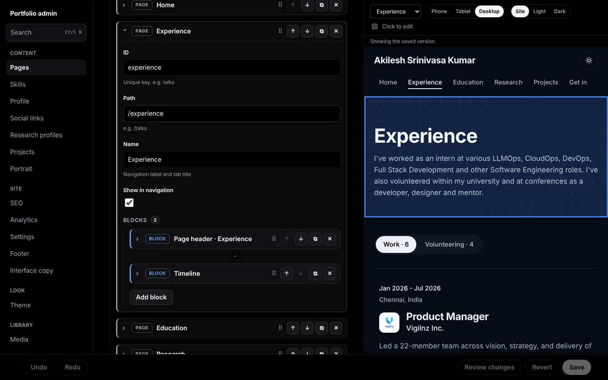
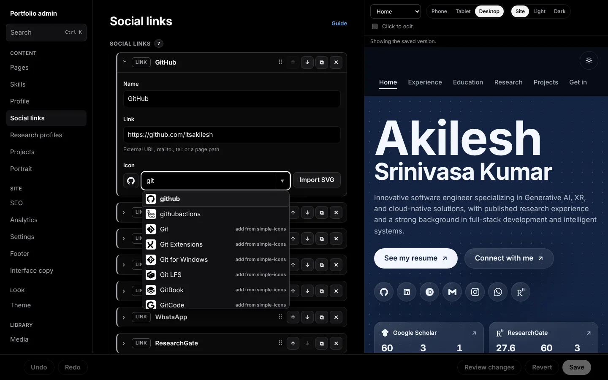
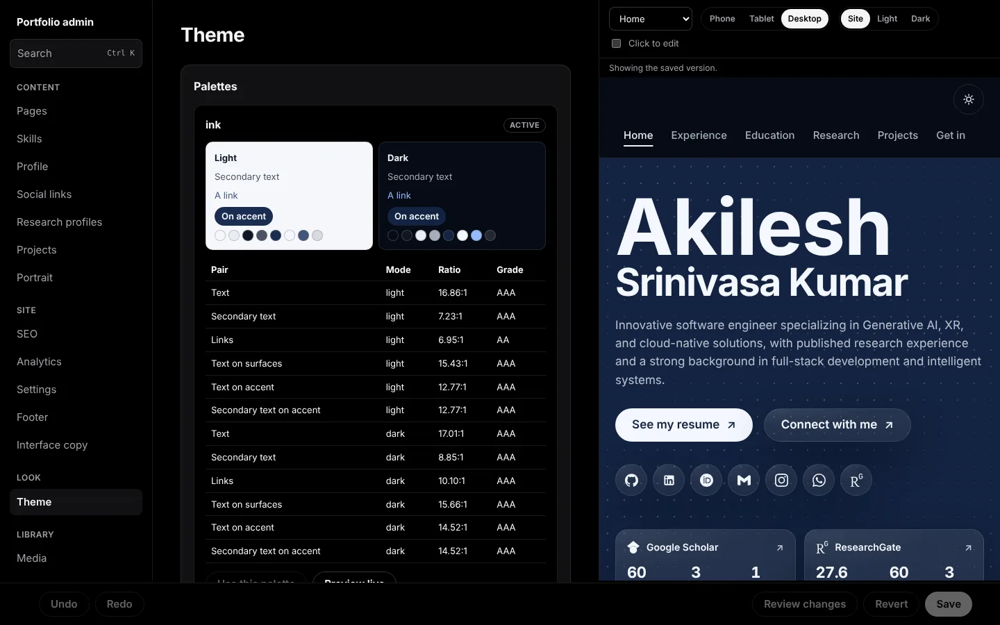
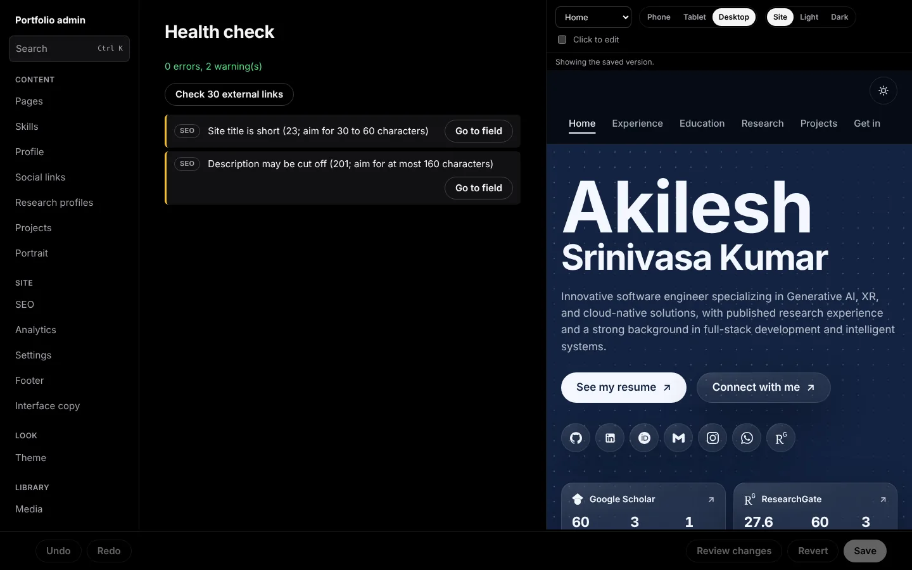

<!--
  File: README.md
  Purpose: The single guide to Portfolio-inator: what it is, how to run it, make it yours and deploy it.
  Author: Akilesh
  Date: 2026-10-20 (updated 2026-10-22)
-->

# Portfolio-inator

### A portfolio you edit like a document, not like a codebase.



[](LICENSE)
[](https://nodejs.org)
[](https://react.dev)
[](https://www.typescriptlang.org)
[](https://vite.dev)
[](https://pnpm.io)
[](https://itsakilesh.github.io)

Everything your site shows lives in one JSON file. Change it by hand, or open a local admin console
that writes the file for you, with a live preview beside every field. No component code to touch,
no database, no server to pay for. It builds to a static site you can host on GitHub Pages for free.

**Live example:** [itsakilesh.github.io](https://itsakilesh.github.io)

If this saves you a weekend, a star on the repo is the nicest thank-you.

## Where this came from

For five or six years my portfolio ran on
[**masterPortfolio**](https://github.com/ashutosh1919/masterPortfolio) by
[Ashutosh Hathidara (@ashutosh1919)](https://github.com/ashutosh1919). It was the template I forked as
a student, the one I kept coming back to every time I had something new to show, and the reason I
had a portfolio at all. Thousands of developers can say the same.

Portfolio-inator started as that fork and grew from there: a rewrite in TypeScript, a block-based
page system, a content schema and an admin console. Many of the ideas you will recognise (the
splash screen, the "What I do" skills, the GitHub projects fetched with a token, the experience
tabs) are his ideas first. Thank you, Ashutosh, for an amazing run, and to everyone who contributed
to masterPortfolio along the way.

## What you get

- [x] Home page with your name, summary, buttons, social links and a cloud of your skill icons
- [x] "What I do" skills with icons for every tool
- [x] Experience with tabs (work, volunteering, anything you like)
- [x] Education
- [x] Research: patents, publications with filters, Google Scholar and ResearchGate numbers
- [x] Projects pulled from your GitHub (pinned and public repositories)
- [x] Contact page and a links page
- [x] Your own pages, built from blocks, with any path you choose
- [x] Light and dark mode, five colour palettes, or your own
- [x] SEO tags, link previews, Google Analytics and Microsoft Clarity (all optional)
- [x] A local admin console to edit all of it, with a live preview
- [x] Works on phones

## Contents

- [Screenshots](#screenshots)
- [Clone and use](#clone-and-use)
- [Make it yours](#make-it-yours)
- [Common tasks](#common-tasks)
- [Configuration reference](#configuration-reference)
- [GitHub projects](#github-projects)
- [Deployment](#deployment)
- [Testing](#testing)
- [Technologies used](#technologies-used)
- [Thanks](#thanks)
- [License](#license)

## Screenshots

| Light | Dark |
| --- | --- |
|  |  |
|  |  |

<p align="center"></p>

**The admin console** (it only exists on your machine while `pnpm dev` runs):

| Pages and blocks, with the live preview | Icon search across all of simple-icons |
| --- | --- |
|  |  |
| **Theme studio with contrast scores** | **Health check before you publish** |
|  |  |

## Clone and use

You need [Node.js 22.12 or newer](https://nodejs.org) and [pnpm](https://pnpm.io)
(`corepack enable` sets pnpm up for you).

```bash
# Fork the repo on GitHub first, then:
git clone https://github.com/<your-username>/portfolio-inator.git
cd portfolio-inator
pnpm install
pnpm dev
```

Open [localhost:5173](http://localhost:5173) for the site and
[localhost:5173/admin](http://localhost:5173/admin) for the admin console.

Prefer Docker? `docker compose up` serves the same dev server at
[localhost:3001](http://localhost:3001).

## Make it yours

There are two ways to edit, and you can mix them freely. Both change the same file,
`src/content/portfolio.json`.

### Option 1: the admin console (recommended)

1. Run `pnpm dev` and open `/admin`.
2. Open **Setup wizard** in the sidebar. The wizard walks you through your name, links and colours, and can
   clear my sample content (experience, education, research and so on) in one click.
3. Edit anything in the sidebar. The preview on the right follows along.
4. Click **Save**. That writes `portfolio.json`. Your unsaved edits are kept in the browser, so a
   closed tab does not lose them.

Handy things to know:

- **Ctrl/Cmd + K** searches every section and every piece of content.
- **Ctrl/Cmd + Z** and **Ctrl/Cmd + Shift + Z** undo and redo.
- **Review changes** shows everything you changed before you save, and lets you undo any one item.
- Tick **Click to edit** above the preview, then click any block on the page to jump to its fields.
- **History** keeps a copy of every save, so you can always go back.
- **Guides** has a short guide for each part of the console.

The console is a development tool only. It is removed from the production build, and the build
fails if any part of it sneaks in.

### Option 2: edit the JSON by hand

Open `src/content/portfolio.json` in VS Code. The file has a schema, so you get autocomplete and an
explanation for every field as you type. If you make a mistake, `pnpm dev` and `pnpm build` tell
you exactly which field is wrong instead of showing a broken page.

## Common tasks

Each example shows the admin route and the JSON it produces.

### Change your name, summary and buttons

**Admin:** Profile.

```json
"profile": {
  "title": "Ada Lovelace",
  "logo_name": "Ada Lovelace",
  "subTitle": "Analyst of engines, writer of the first program.",
  "resumeLink": "https://example.com/ada-resume.pdf",
  "resumeLabel": "See my resume",
  "connectLink": "https://www.linkedin.com/in/ada",
  "connectLabel": "Connect with me"
}
```

### Add a job

**Admin:** Pages, then Experience, then the Timeline block, then **Add**.

```json
{
  "title": "Product Manager",
  "company": "Analytical Engines Ltd",
  "company_url": "https://example.com",
  "logo_path": "engines.webp",
  "dates": { "label": "", "start": "2024-03", "end": "present", "isEndExpected": false },
  "location": "London, UK",
  "description": "What you did, in a few sentences."
}
```

Dates are flexible: `"2024"`, `"2024-03"` or `"2024-03-15"`. Use `"present"` for an ongoing role,
set `isEndExpected` to show "(expected)" for a degree you have not finished, and use `label` for a
prefix such as "Filed" or "Issued". The admin console gives you a date picker for all of this.

### Add a social link

**Admin:** Social links, then **Add**. In the icon field, type the name of the service. Every icon
on [simpleicons.org](https://simpleicons.org) is searchable, and picking one adds it to your library
automatically. Nothing to download.

```json
{ "name": "GitLab", "link": "https://gitlab.com/ada", "icon": "gitlab" }
```

Have a logo that is not on simple-icons? Click **Import SVG** next to any icon field.

### Add a new page

**Admin:** Pages, then **Add page**. Start from a template (talks, writing, links, contact and
more) or a blank page, then add blocks from the block palette.

```json
{
  "id": "talks",
  "path": "/talks",
  "label": "Talks",
  "showInNav": true,
  "blocks": [
    {
      "type": "header",
      "title": "Talks",
      "description": "Conferences and meetups.",
      "showPortrait": false,
      "showResearchCards": false
    },
    { "type": "text", "heading": "Upcoming", "body": "**March:** Engines at scale, London." }
  ]
}
```

Pages appear in the navigation in the order you list them, and the first page is your home page.

### Import publications or a resume

**Admin:** Import & export.

- **BibTeX:** paste the export from Google Scholar, Zotero or any reference manager, and pick the
  publications block to add them to.
- **JSON Resume:** upload a [JSON Resume](https://jsonresume.org) file to fill in your profile, jobs
  and education in one go.
- **JSON:** export your whole content as a backup, or import one.

### Change colours

**Admin:** Theme. Every palette shows its contrast scores, so you know the text stays readable.
Click **Preview live** to try one in the preview before you commit to it.

```json
"theme": {
  "activePalette": "klein",
  "palettes": {
    "mine": { "kind": "generated", "hue": 150, "chroma": 0.14, "lightness": 0.42 }
  }
}
```

A generated palette needs just one hue (0 to 360) and builds light and dark versions for you.

### Add images

**Admin:** Media. Upload images and they are converted to WebP and resized in your browser before
they are saved to `public/images/`. In the JSON, refer to an image by its file name:
`"logo_path": "engines.webp"`.

### Turn off the splash screen or the dotted background

**Admin:** Settings.

```json
"settings": { "isSplash": false, "showDotField": true }
```

## Configuration reference

All content is in `src/content/portfolio.json`:

| Key | What it holds |
| --- | --- |
| `site.profile` | Name, summary, resume and connect buttons |
| `site.socialLinks` | Links shown on the home and contact pages |
| `site.seo` | Page title, description, link-preview image, favicon, search-console tokens |
| `site.analytics` | `googleAnalyticsId` and `clarityId`. Leave one empty to turn it off |
| `site.settings` | Splash screen and dotted background |
| `site.researchProfiles` | Google Scholar and ResearchGate numbers |
| `site.projects` | Which GitHub repositories to feature, and icons for languages |
| `site.footer`, `site.ui` | Footer text and small pieces of interface text |
| `theme` | Palettes, the active palette, default light or dark mode, fonts |
| `skills` | "What I do" groups and their tool icons |
| `pages` | Every page and its blocks, in navigation order |

Blocks you can put on any page:

| Block | Shows |
| --- | --- |
| `hero` | Name, summary, buttons, social links, skill icons, research cards |
| `skills` | "What I do" |
| `header` | A title band, with an optional portrait or research cards |
| `timeline` | Jobs or roles with logos and dates, with tabs for several groups |
| `degrees` | Education |
| `featured` | Large cards, such as patents |
| `publications` | A filterable list of publications |
| `projects` | Your GitHub repositories |
| `contact` | Email, phone and social links |
| `linkGrid` | A grid of links |
| `text` | A heading and Markdown text |
| `image` | One image with an optional caption |
| `callout` | A highlighted note (an example of a custom block) |

Need something else? Copy `src/blocks/custom/callout` to a new folder and change its two files.
It shows up in the schema, the admin console and the site automatically. See
[docs/admin/custom-blocks.md](docs/admin/custom-blocks.md).

## GitHub projects

The Projects page shows your pinned and public repositories. To refresh them:

1. Create a [GitHub personal access token](https://github.com/settings/tokens) with read-only
   access to public repositories.
2. Create a file called `.env` in the project folder:

   ```env
   GITHUB_TOKEN=your_token_here
   GITHUB_USERNAME=your_username
   ```

3. Run `pnpm fetch-data` (or click **Fetch from GitHub** under Projects in the admin console).

Keep your token secret. `.env` is already in `.gitignore`, so never commit it, never paste it into
`portfolio.json`, and revoke it on GitHub if it ever leaks.

## Deployment

`pnpm build` checks your content, builds the site into `./build` and confirms no admin code is in
it. Anything that hosts static files can serve that folder.

### GitHub Pages (automatic)

The included workflow, `.github/workflows/deploy.yml`, tests, builds and publishes the site every
time you push to `main`. It publishes to a separate repository named `<username>.github.io`, so your
site lives at `https://<username>.github.io`.

1. Create an empty repository named `<your-username>.github.io`.
2. In `deploy.yml`, change `external_repository` to `<your-username>/<your-username>.github.io`.
3. Create a [fine-grained token](https://github.com/settings/personal-access-tokens) with
   **Contents: read and write** on that repository, and add it to this repository under
   **Settings > Secrets and variables > Actions** as `PAGES_DEPLOY_TOKEN`.
4. In the `.github.io` repository, open **Settings > Pages** and serve from the `main` branch.
5. Push to `main`.

Deep links such as `/research` keep working on GitHub Pages thanks to `public/404.html`.

### Anywhere else

Run `pnpm build` and upload `./build` to Netlify, Vercel, Cloudflare Pages or your own server.

## Testing

```bash
pnpm test        # unit and integration tests (Vitest)
pnpm test:e2e    # browser tests, including accessibility checks (Playwright and axe)
pnpm build       # type check, content check and production build
```

The first time you run the browser tests, install Chromium with `pnpm exec playwright install chromium`.

## Technologies used

- [React 19](https://react.dev) and [TypeScript](https://www.typescriptlang.org)
- [Vite](https://vite.dev)
- [React Router](https://reactrouter.com)
- [Zod](https://zod.dev) for the content schema
- [simple-icons](https://simpleicons.org) for brand icons
- [Vitest](https://vitest.dev), [Playwright](https://playwright.dev) and
  [axe](https://github.com/dequelabs/axe-core) for testing

## Thanks

- [**Ashutosh Hathidara**](https://github.com/ashutosh1919) and every contributor to
  [masterPortfolio](https://github.com/ashutosh1919/masterPortfolio), the project this one grew from.
- [Saad Pasta's developerFolio](https://github.com/saadpasta/developerFolio), which inspired
  masterPortfolio in turn.
- [simple-icons](https://simpleicons.org) for thousands of brand icons.

## License

[MIT](LICENSE). Use it, fork it, make it yours. The license keeps Ashutosh Hathidara's original
copyright notice for masterPortfolio alongside this project's.
